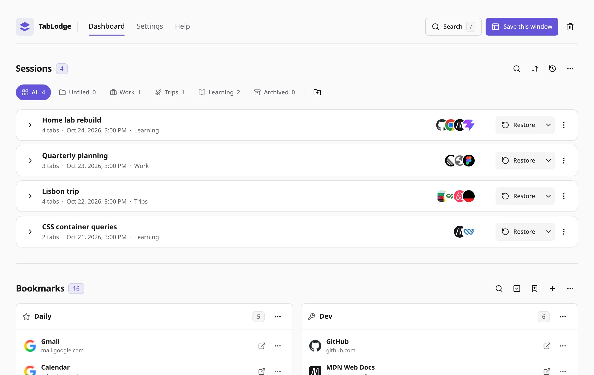
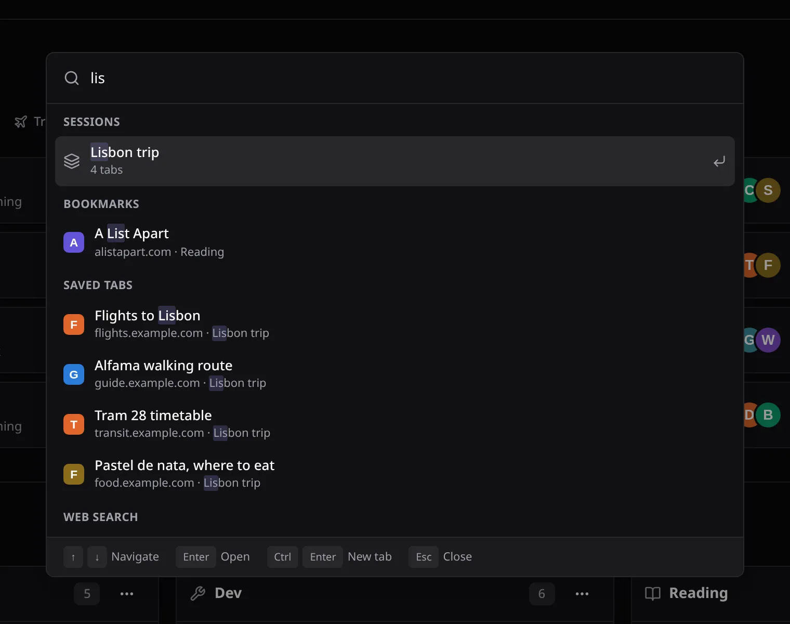
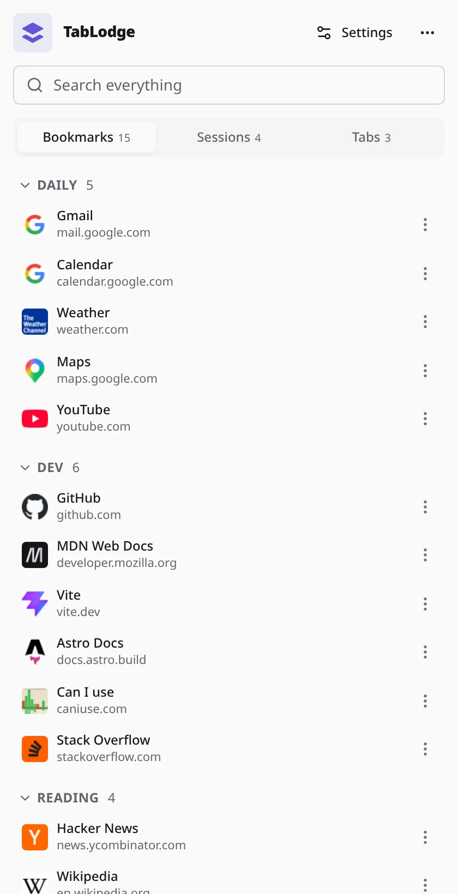

<h1 align="center">
  <br>
  TabLodge
</h1>

<p align="center"><strong>Save your tabs for later. Keep your bookmarks on every new tab.</strong></p>

<p align="center"><a href="https://tablodge.bbay.dev">tablodge.bbay.dev</a></p>
<p align="center"><a href="https://chromewebstore.google.com/detail/tablodge-%E2%80%93-tab-session-ma/ekidoclgpdfhpdlidlkcjccgihbndoib"></a></p>
<p align="center"><a href="https://addons.mozilla.org/firefox/addon/tab-lodge/"></a></p>

<p align="center">
  <a href="https://github.com/bberka/TabLodge/actions/workflows/test.yml"></a>
  <a href="../LICENSE"></a>
  
</p>

TabLodge is a browser extension for Chromium browsers (Chrome, Brave, Edge, Vivaldi, Opera) and desktop Firefox. Save a window as a named session, close it, and bring it back later. Your new tab page becomes a board of bookmark columns.

TabLodge has no accounts and no analytics. Your data stays in your browser profile, and TabLodge talks to no server unless you turn on sync with one you run yourself.

## Features

- **Sessions.** Save tabs, a tab group, a window, or all windows, and restore them with their groups and pinned tabs. Organize sessions in folders, archive old ones, and replace, extend, or split a session from the current window.
- **Bookmark board.** Columns of links on every new tab, in a Focus view (the default: a column list that starts with **All**, a system item listing every bookmark, next to one open column; **Settings › Bookmark board › Show All in the bookmark list** turns All off, here and on the phone) or a Board view, each column with its own icon and color. Drag or use the keyboard to reorder (also from the Focus column list), paste lists of links, and find duplicates.
- **Search.** A palette (`Ctrl+Shift+K` on any page, `Ctrl+K` or `/` on the dashboard) and the `tl` address bar keyword find open tabs, bookmarks, saved tabs, and sessions.
- **Import and export.** Bring data from OneTab, Session Buddy, Tab Session Manager, Toby, Raindrop.io, or browser bookmarks. Imports add to what you have and skip links you already saved; a full backup can be added or can replace everything. Share or save one session, column, or selection from a single **Share** dialog (links, Markdown, a web page, rich text, JSON, CSV, or a browser bookmarks file), or save a full backup ZIP, optionally protected with a password.
- **Recovery.** Crash snapshots, a trash bin, Undo, and optional automatic backups.
- **Sync with your own server.** Keep the library the same in all your browsers through a server you run yourself, with Docker or on your Cloudflare account. On Cloudflare, a Deploy to Cloudflare button sets it up without installing anything. See [Self hosting](self-hosting.md).
- **Private windows.** Use the regular library or a separate one, optionally locked with a PIN or password. See [Private windows](#private-windows).
- **Popup, dashboard, and side panel**, with light and dark themes and your choice of accent color.

The in app Help page explains every feature and setting.

## Screenshots

<p align="center">
  
</p>
<p align="center">
  
  
</p>

## Install

**Chromium browsers:** [install from the Chrome Web Store](https://chromewebstore.google.com/detail/tablodge-%E2%80%93-tab-session-ma/ekidoclgpdfhpdlidlkcjccgihbndoib). It works in Chrome, Brave, Edge, Vivaldi, Opera, and other Chromium browsers, and updates itself.

**Manual install:** download `tablodge-0.x.y.zip` from the [latest release](https://github.com/bberka/TabLodge/releases/latest) and unzip it into a folder you keep. Open your browser's extensions page, turn on **Developer mode**, choose **Load unpacked**, and select the folder. To update, replace the folder's contents and reload TabLodge. A manual copy and the store copy keep separate data, so move between them with a full backup (**Settings › Data › Back up › Everything**).

**Firefox:** desktop Firefox 140 or newer. [Install from Firefox Add-ons](https://addons.mozilla.org/firefox/addon/tab-lodge/). It updates itself.

**Manual Firefox install:** use the unsigned `tablodge-0.x.y-firefox.zip` from the [latest release](https://github.com/bberka/TabLodge/releases/latest):

- To try it, open `about:debugging#/runtime/this-firefox` and choose **Load Temporary Add-on**. Firefox removes it on restart, but keeps its data.
- To keep it, use Firefox ESR, Developer Edition, Nightly, or an unbranded build, set `xpinstall.signatures.required` to `false` in `about:config`, and install the ZIP from `about:addons`.

In Firefox, TabLodge always replaces the new tab page, the side panel is Firefox's sidebar, saved items show letter tiles instead of site icons, private windows are not supported, and split view tabs reopen as neighboring tabs. See [Browser support](architecture.md#browser-support).

**Android:** Android 7 or newer. Download `tablodge.apk` from the [latest release](https://github.com/bberka/TabLodge/releases/latest), open it on your phone, and allow your browser or file manager to install apps when Android asks. There is no store listing yet, and the app does not update itself: install the next release's APK over the old one, and your data stays. Compare the file with `tablodge.apk.sha256` if you want to check the download. The app saves links and shows your bookmarks and sessions from your [sync server](self-hosting.md); see [Android app](#android-app).

### Build from source

You need Git, Node.js 22.18+ or 24.11+, and the [Vite+ CLI](https://viteplus.dev/).

```sh
git clone https://github.com/bberka/TabLodge.git
cd TabLodge
corepack enable
pnpm install
vp run build
```

Load `apps/extension/dist/tablodge/` with **Load unpacked**, or `apps/extension/dist/tablodge-firefox/manifest.json` as a temporary add-on in Firefox. `vp run pack` makes the release ZIPs under `release/`. To update, run `git pull`, `pnpm install`, and `vp run build`, then reload TabLodge.

## Private windows

In Chromium, turn on **Allow in Incognito** for TabLodge. The first private dashboard asks whether private windows use the regular library, a separate saved one, or a separate temporary one that clears when the browser restarts. Change it later in **Settings › Private windows**.

### Lock a separate saved library

A separate saved library can be locked with a PIN (4 to 8 digits) or a password (8 to 128 characters) from **Settings › Private windows** in a private window. TabLodge then encrypts it on this device and shows a lock screen until you enter it. It locks again on **Lock now**, after an idle time, when you lock your screen, and when the last private window or the browser closes. Nothing can recover a lost PIN or password, and a short PIN is easy to guess for someone with a copy of your profile. See [Privacy](PRIVACY.md#private-windows) for details.

## Development

Install the [Vite+ CLI](https://viteplus.dev/) once, run `pnpm install`, then use `vp run <task>` from the repository root.

| Command | What it does |
| --- | --- |
| `vp run dev:chrome` | Build, watch, and open a test browser with TabLodge loaded (`:seed` adds sample data) |
| `vp run dev:firefox` | The same in Firefox |
| `vp run check` | Lint, type checks, and tests |
| `vp run a11y` | Accessibility and keyboard checks on the built extension |
| `vp run build` / `vp run pack` | Build and verify both browsers, then package them |
| `vp run lint:fix` | Fix lint issues and format with XO |
| `pnpm run mobile:start` | Start Metro for the Android app in `apps/mobile/` (needs a development build; see [Android app](#android-app)) |
| `pnpm run mobile:apk` | Build a standalone Android APK from this checkout into `apps/extension/dist/tablodge-local.apk`; add `--install` to install it with adb, or `--all-abis` to include 32 bit ARM |
| `pnpm run mobile:export` | Bundle the Android app's JavaScript to check that it builds |
| `pnpm run cf:setup` | Deploy the sync server to Cloudflare (see [Self hosting](self-hosting.md)) |
| `pnpm run cf:bundle` | Rebuild `apps/server/cloudflare-deploy/worker.js` after changing the server or the sync code |

The test browser keeps its own profile in `apps/extension/.dev/`, apart from your regular one. After a rebuild, reload TabLodge on the extensions page. Headless variants (`dev:chrome:headless`, `dev:firefox:headless`) are for automated checks; see [Agent validation](agents/validation.md#browser-access).

Read [Contributing](CONTRIBUTING.md) for conventions, tests, and releases, and [Architecture](architecture.md) for storage, messages, and sync. AI agents also follow [AGENTS.md](../AGENTS.md).

### Android app

`apps/mobile/` holds an Android app, still in development. Each [release](https://github.com/bberka/TabLodge/releases/latest) attaches a signed APK (see [Install](#install)), and pull requests that touch the app build a debug APK as a workflow artifact. It is a small link saver in the style of Raindrop:

- Bookmarks: browse columns (the first chip, **All**, lists every bookmark and is the one shown first; **Settings › Bookmarks › Show All in the bookmark list** hides it, and it is the same setting as in the extension; the three-dot menu is in the top bar), search (the round search button beside the add button opens a search bar at the bottom of the screen, above the keyboard: a floating rounded bar with the floating tab bar, a banner across the screen with the docked one), add links, and tap one to open it. Swipe a row right to open it or left to delete it (with Undo), or long press a row for its menu (Open, Edit, Move to column, Select, Export, Delete). **Select** picks several, then open, export, move, or delete them together. Selecting one row also offers Edit for its link, title, and column. **Open all** opens every link in a column.
- Share sheet: choose TabLodge from another app's share menu and a drawer slides up with the link and title filled in. When the share started the app, saving returns you to the app you came from.
- Duplicates and details: the bookmarks **More actions** menu has **Remove duplicates**, which keeps the oldest copy of each saved address and can be undone. A session's **Edit details** (menu or swipe) changes its name and description, which show on its card and sync with the extension.
- Chip menus: holding a bookmark column chip selects it and opens the same menu as the three dots (Open all, Select, Put in order, Edit column, Move column earlier or later, Delete column, Remove duplicates, Manage columns); hold a session folder chip for Share (every chip has it, including All) and, for a folder you made, Edit folder (name, icon, color, and whether it colors the sessions moved into it) and Delete (its sessions move to Unfiled, with Undo). **New folder**, the last session chip, makes one. Unfiled and Archived cannot be renamed or deleted, and the private library only opens and shares. TalkBack gets a More actions action on each chip.
- Import and export: **Settings › Import and export** has two buttons: **Import, export and backup**, a menu of the actions below, and **Erase**. Import reads a file you pick, or links you paste, with the same reader as the extension: its own JSON, browser bookmark HTML, CSV, Markdown, link lists, and OneTab, Session Buddy, Tab Session Manager, Toby, and Raindrop.io exports. A preview shows what it found and how many links are already saved, which are skipped by default, and a file that holds both sessions and bookmarks asks which to import. **Share or back up** opens one sheet: pick sessions or bookmarks, then links, Markdown, a web page, JSON, CSV, or a bookmarks file, and **Share** hands it to Android's share sheet; **Everything** saves a full backup ZIP in the extension's layout, with an optional password (a `.zip.enc` file, the same envelope the extension writes), which the extension restores. **Restore a backup** reads a full backup ZIP, from the phone or the extension (a password-protected one asks for its password first), and offers **Restore everything** (replaces the library and brings back the phone's settings; it asks first) or **Restore phone settings only** (only for a backup made on the phone). **Statistics** lists how much is saved, and **Erase sessions**, **Erase bookmarks**, and **Erase everything** delete them after asking; settings are kept. One session, a folder, a column, a single bookmark, or the selected bookmarks open the same sheet from their menus with **Share**; there is no separate Export.
- Sessions: saved sessions are listed by folder, as in the extension: **All** (without Archived), each folder with its count, and **Archived** last. Tap a tab to open it, or **Open all** for the whole session. A phone browser cannot list its own tabs, so the app cannot capture them. Instead, share several links at once (in Chrome, select tabs in the tab switcher and choose Share tabs; in Firefox, Share all tabs) and a drawer asks whether to save them as bookmarks, as a new session, or into a session that exists.
- Open links: **Settings › Open links** picks where a link opens: the default browser (the default), an in-app tab that opens over TabLodge and returns to it when closed, or one of the browsers installed on the phone, listed with each app's own icon. **Private library links** takes its own choice, or follows the other one. Chrome ignores a request for a private tab from another app, so private links cannot be forced into incognito; point them at a private browser (Firefox Focus, DuckDuckGo, Brave) instead. If the chosen browser is gone, the default browser opens the link. Both choices stay on this phone.
- Private library: a library of its own on the phone, edited like the regular one (bookmarks, columns, sessions, folders, import, export) and working without a server. **Settings › Private library** sets it up with no lock, a PIN, or a password; the glasses button (or Settings) opens it, and a lock beside it locks it at once. Saving a link or a shared list offers **Regular** or **Private** (a locked one asks for its PIN first). The data key is random and only a copy wrapped by the PIN is kept, in the same envelope the extension uses; the library itself is stored on the phone in the app's private storage, unsealed, so the PIN controls who can open it in the app and who can read it on the server. With a server connected it syncs with the private windows' library on that server, both ways, with every value sealed. If the server's library already has a PIN from the extension, the phone asks for it once and takes that lock; what is on the phone stays and merges. **Lock now** forgets the key and keeps the data, **Delete from this phone** removes it (the server keeps its copy), and a PIN can be added later. **Lock automatically** (for a library with a PIN or password, on this phone only) is Never, when you leave the app, when the screen locks, or after 1, 5, 15, 30 or 60 minutes without a touch. The PIN cannot be recovered. The button tells anyone holding the phone that a private library exists, so **Private library button** turns it off, on this phone only.
- Device names: with sync on, **Settings › Sync** has a Device name (a computer defaults to the browser and system, a phone to its make and model). New sessions record it, and session cards show where each was saved. Each device has its own name, kept on that device; a rename does not change sessions already saved.
- Preview when saving: the save drawer shows the page's icon and fills in an empty title, through your server when one is connected and straight from the site otherwise. **Preview links when saving** turns it off; it is on by default and stays on this phone.
- Site icons: with a server connected, icons load through it by default, so the server fetches them and sites never see the phone. **Settings › Bookmarks › Site icons** can also let a phone without a server ask each site itself (**From the sites too**), or turn icons off. A letter tile shows until an icon arrives or when a site has none. The extension's hover previews with images are not in the app.
- Session actions: long press a session card, or use its **More** button, for Open all, Edit details (name, description, folder, and color), Add links (paste addresses into the session), Save links as bookmarks (into a column you choose or make), Share, Archive, and Delete (with Undo). Long press a link in a session for its menu: Open, Edit (its title and address), Add to bookmarks, and Delete (with Undo); holding a link never deletes it by itself. **Settings › Sessions** chooses what a tap does (show tabs or open all), what the main button at the foot of an open card does (Open all by default), and what a swipe right and left do; the default is Archive on the right and Delete on the left. The private library allows only opening and sharing.
- Settings sync: with sync on, your settings follow your other devices, including this app's own (look, floating bar, tap and swipe actions, the main button on a session, cleaning links on save, saving previews, and how site icons load). It is on by default and **Settings › Sync settings** turns settings sync off for one phone, the same switch the extension has. **Sync the private library**, next to it, turns off the private library's sync on one phone: it then stays on that phone and never reaches the server. The app's own settings travel in the library's `mobileApp` setting, which the extension keeps but does not use.
- Accent color (Android): **Settings › Appearance › Accent color**. The default is **TabLodge**, the app's purple, the same as the extension. **System color** is the phone's own Material You color (Android 12 and later, read once when the app starts; older phones and the iOS look keep TabLodge's own), and the palette and the palette swatch give a preset or any color. Colors are moved toward black or white until text in them is readable, and the choice syncs with the app's other look settings.
- Color picker (Android): the color drawers show the selected color's name, the preset swatches, and a palette swatch that opens hue and shade bars you drag (a screen reader steps them) and a hex field. A drag saves once, when the finger lifts.
- Session colors: a session can have a color, set in **Session details** in the extension (the same selector as column colors) and in **Edit details** in a session's menu on Android (long press the card, or the three-dot button in an expanded card). The color shows as a line on the top of the card in the extension and tints the card's tile on Android. It syncs with the session.
- Folder colors: a folder can have a color and a switch, **Update session colors to folder color when moved**, both set in **Edit folder** in the extension. The color tints the folder's icon in the folder selectors. With the switch on, a session moved into the folder (menu, drag, or **Session details**) takes the folder's color; a color chosen in the same **Session details** save wins, and sessions already in the folder keep theirs. The Android app keeps the color and the switch in sync, applies them when you move a session there, and sets them in **Edit folder** or **New folder**.
- Columns: every column selector shows the column's icon and color, and ends with **New column**, which asks for a name, an icon, and a color. The three-dot button in the top bar opens **Manage columns** (open, put in order, or change any column), **Edit column** (name, icon, and color, or delete it, and its bookmarks move to another column or are deleted with it), **Put bookmarks in order**, and **Select bookmarks**. The icon button opens a drawer with a fuzzy search over the icon names and topics, the same as the extension's. The color and icon sync with the extension, where a column's color is set in its Edit column dialog with the same selector as the accent color.
- Order: **Manage columns** moves a column up, down, to the top, or to the bottom, and **Put bookmarks in order** does the same for a bookmark inside its column. The order syncs with the extension.
- Excluded websites: **Settings › Excluded websites** lists the sites that are not saved from the phone, the same list as the extension's (it syncs both ways). An entry covers the site and its subdomains. A link to an excluded site is refused in the Save link drawer, and left out of a shared list.
- Settings search: the round search button in Settings opens a search box at the bottom of the screen that filters the cards and rows as you type. It matches a setting's name or its hint, so `swipe`, `tracking`, or `private` find what you mean. **Restore default preferences**, at the bottom, asks first and puts the app's settings back to their defaults; the library, server connection, phone name, and the extension's settings stay.
- Deleting: removing a session, a bookmark, a tab in a session, a session folder, or a column does not ask; a snackbar offers Undo. Sessions has the same add and search buttons as Bookmarks. Dangerous actions in Settings, such as disconnecting or deleting the private library from the phone, still ask first.
- Behavior: **Settings › Bookmarks** chooses what a tap does (open or edit) and what a swipe right and left do (open, edit, move, delete, or nothing). **Settings › Links and titles** changes the extension settings that sync: clean titles, tracking parameters, how addresses show, and cleaning links when saving. Choices such as swipe actions, how addresses show, and session sorting are one line rows that open a drawer, and bookmark spacing and the session card options (compact cards, tab icons, saved on, expanded by default) are switches. Settings that only make sense in a desktop browser (new tab, side panel, context menus, windows, snapshots) are not shown.
- Sync: it connects to your [sync server](self-hosting.md) with the same address and token as the extension, using the shared client in `apps/extension/src/shared/sync/`. While the app is in front, a live connection brings changes in within a second or two. When you leave the app, it first sends any change that is still waiting, then closes that connection and its timers, so it does not keep the radio or the battery busy. When you come back it reconnects and catches up. A change made with no connection is kept and goes out by itself once the server is reachable again. There is no background sync, so changes from other devices show up when you open the app.
- Look: **Settings › Appearance** chooses a **Theme** (the phone's own, light, or dark), the **Accent color**, a **Style** that is Automatic by default (the Material look on Android, the iOS look on an iPhone) or set to the Android or iOS look, and turns the floating tab bar on or off, which is on by default. The docked tab bar is the same in both looks: a tall bar with a pill behind the selected icon and name. The theme syncs with the app's other look settings.

[ADR 3](adr/0003-mobile-app-framework.md) explains the framework choice. The app is not published and is not part of the extension build.

To run it you need JDK 17 or newer and the Android SDK (`ANDROID_HOME` set). `pnpm run mobile:android` builds a development build and installs it on a connected device or emulator, and `pnpm run mobile:start` serves the JavaScript to it. `pnpm run mobile:apk` builds a standalone APK of the current checkout (JavaScript bundled in, arm64 only) at `apps/extension/dist/tablodge-local.apk` for trying on a phone, and `--install` installs it on the connected device. It is signed with a local debug key, so it cannot update the released app: uninstall that first, which removes its local data. `pnpm run mobile:doctor` checks the Expo setup, and `pnpm run mobile:export` bundles the JavaScript without a device. In a development build, the app starts with the same sample sessions and bookmarks as `dev:chrome:seed` (the fixture in `apps/extension/src/shared/dev-fixture.ts`), once, when its library is empty and no server is connected. Set `EXPO_PUBLIC_SEED_DATA=0` to start empty instead. **Settings › Development** can load the samples again or clear the library. Sample data never reaches a server: those buttons are off while a server is connected, and connecting removes the samples first. Release builds do not contain the sample data. The sharing logic is tested in `apps/mobile/tests/mobile-library.test.ts` and `apps/mobile/tests/mobile-sync.test.ts`.

### Project structure

```text
apps/extension/   The browser extension (Chrome, Brave, Firefox)
  shell/            Manifest, icons, HTML shells, service worker
  src/app/          Extension pages, data types, and messages
  src/shared/       Shared helpers, library storage, and the sync protocol (src/shared/sync/), also used by the server and the Android app
  src/components/ui/  UI primitives (Radix and Tailwind)
  styles/           Tailwind stylesheet for the extension pages
  scripts/          Build, packaging, dev browser, and accessibility tooling
  tests/            Vitest suites with mocked browser APIs
apps/server/      Self hosted sync server for Docker and Cloudflare (cloudflare-deploy/ is what the Deploy to Cloudflare button copies)
apps/mobile/      Android app (Expo and React Native), in progress
apps/site/        Website for tablodge.bbay.dev (vp run site:dev)
scripts/          Repository wide tooling (release versioning)
tsconfig/         TypeScript settings shared by every app
docs/             All documentation except AGENTS.md
.hooks/           Git hooks that run the checks before commits and pushes
```

## Permissions and privacy

TabLodge has no website host permissions and no content scripts, and makes no network requests unless you turn on sync, which talks only to your server.

| Permission | Why |
| --- | --- |
| `tabs`, `tabGroups` | Save and restore tabs and their groups |
| `bookmarks` | Import browser bookmarks and offer to add new ones |
| `favicon` | Show icons from the browser's own cache (Chromium) |
| `storage`, `unlimitedStorage` | Keep the library on this device |
| `contextMenus` | Save and bookmark from right click menus |
| `clipboardWrite` | Copy links when you ask |
| `sidePanel` | The side panel (Chromium; Firefox uses its sidebar) |
| `search` | **Search the web** with your default engine |
| `alarms` | Snapshots, backups, trash cleanup, archiving, sync, and the private lock |
| `idle` | Lock the private library when you lock your screen |
| `activeTab`, `scripting` | Show the search palette over the current page when you press its shortcut |

Preview cards (**Settings › Preview links on hover**, off by default) need no extra permission: the extension asks the sync server it is already connected to, and the server fetches the page.

`downloads` is optional and requested only for backup copies in `Downloads/TabLodge/`. A web page can tell TabLodge is installed by requesting `palette.html`, which the palette needs. See [Privacy](PRIVACY.md) for everything TabLodge stores and sends.

## Contributing

Bug reports, ideas, and pull requests are welcome. Read [Contributing](CONTRIBUTING.md) first, and open an issue before larger changes.

## License

[MIT](../LICENSE) © 2026 Berkay
