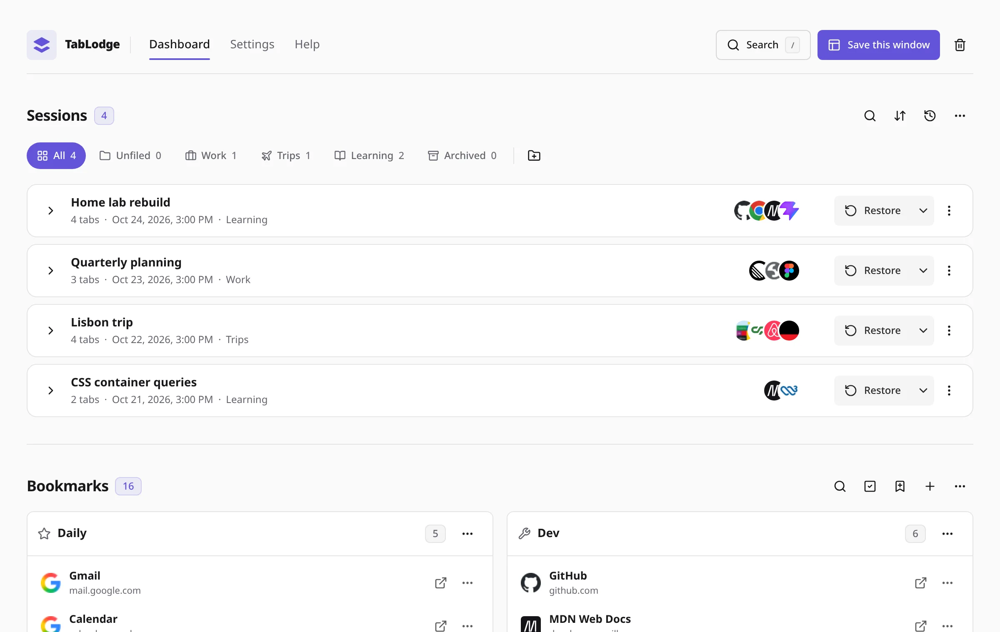
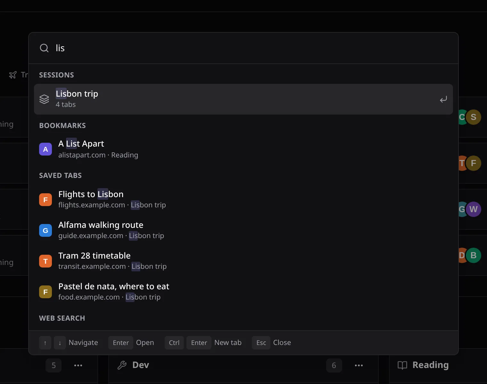
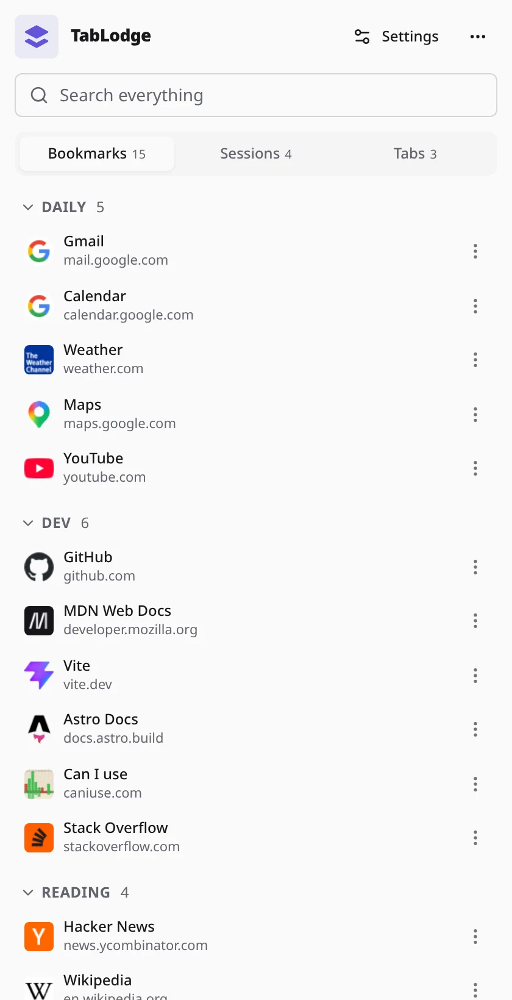

<h1 align="center">
  <br>
  TabLodge
</h1>

<p align="center"><strong>Save your tabs for later. Keep your bookmarks on every new tab.</strong></p>

<p align="center"><a href="https://tablodge.bbay.dev">tablodge.bbay.dev</a></p>
<p align="center"><a href="https://chromewebstore.google.com/detail/tablodge-%E2%80%93-tab-session-ma/ekidoclgpdfhpdlidlkcjccgihbndoib"></a></p>

<p align="center">
  <a href="https://github.com/bberka/TabLodge/actions/workflows/test.yml"></a>
  <a href="../LICENSE"></a>
  
</p>

TabLodge is a browser extension for Chrome, Brave, Edge, Vivaldi, Opera, and other Chromium browsers, and for Firefox on desktop. Save a window as a named session, close it, and bring it back when you need it. Your new tab page also becomes a board of bookmark columns.

There are no accounts, servers, or analytics. TabLodge keeps your data in your browser profile and doesn't sync it between devices.

## What you can do

- **Save and restore sessions.** Save selected tabs, a tab group, tabs to the left or right, a whole window, or all windows. Restores preserve tab groups and, if you choose to save them, pinned tabs. Split view pairs restore side by side on Chromium 155 or newer.
- **Keep sessions organized.** Use folders, icons, descriptions, search, sorting, and custom ordering. Move sessions between folders or merge them without duplicate links. The Archived folder appears when it contains sessions. Archive a session from its card button or menu, or turn on automatic archiving for sessions you haven't opened or edited for 30 days to a year. Archived sessions leave active lists, remain available in Archived, and are not deleted. Move a session to another folder to bring it back. Choose and order up to five session card quick actions in Settings: Archive, Delete, Share, Export session, Edit details, Move up, Move down, and Switch to this session. Archive is selected by default and Delete is off. Enabled actions stay visible on expanded cards. Favicon previews on collapsed session cards are on by default and can be hidden in Settings. Select every saved link in a session with its card checkbox. Keep a session current without saving a new one: **Replace with this window** swaps its links for the window's tabs, **Add this window** appends the tabs it lacks, and **Split** (the selection bar, or **Split selected links** in the session menu) moves the selected links into a new session. Each offers Undo.
- **Choose how restores work.** Open a session in the current window or a new one. Keep or remove saved links afterward, skip URLs that are already open, and optionally unload restored background tabs. Restores of more than 100 tabs open in batches so the browser is not loading hundreds of pages at once. Saving a whole window records its size and position, which you can optionally restore when opening a session in a new window. The browser or window manager may override saved bounds, especially with tiling window managers. Ctrl/Cmd and Shift clicks let you override the usual behavior for one restore. **Switch to this session** (a menu item on the dashboard, a button in the popup and side panel) saves the window's tabs as a new session and opens the chosen one in their place. A setting, off by default, can remove common tracking parameters when opening or copying saved links without changing the stored URLs.
- **Build a bookmark board.** Search your bookmarks, reorder columns and links by dragging or with Move up and Move down in their menus, or paste a list of links to add them to a column or a saved session. The selection bar keeps Open, Move, Export, Share, Add to session, and Delete actions inline. You can also drag selected bookmarks together, and the page scrolls by itself while you hold a drag near an edge. Select several saved session tabs to bookmark them in one column, or drag selected links between the session list and bookmark board. Choose and order up to three quick actions for each bookmark from its menu, including Open in this tab, Open in new tab, Copy link, Edit, Delete, Move to, Move up, and Move down. Open in new tab is selected by default. Columns in Board and Focus are capped scrolling panes by default; turn the limit off to let them grow. Switch between Board and Focus views: Board shows every column in a grid, and Focus shows a column list with one open column. Choose the default, wider, full width, or narrower dashboard layout in Settings. Under Settings › Bookmark board you can also set the minimum column width, the most columns per row, and a compact density that tightens gaps, padding, and rows. **Find duplicate bookmarks** in the bookmark toolbar menu lists addresses saved more than once on the board, across columns. Choose which copy to keep (the oldest by default), remove the rest to the trash bin, and Undo restores them.
- **Bring your data with you.** Import from OneTab, Session Buddy, Tab Session Manager, Toby, or browser bookmarks. Imported bookmark folders become columns, folders with the same name merge, and links without a folder go in the first column. Export individual sessions or bookmark columns, all sessions, or all bookmarks as JSON, HTML, CSV, Markdown, or URL lists. The Sessions menu can share all sessions, including archived ones, as an HTML page, Markdown, plain links, or rich text. A full backup ZIP includes settings and recovery data as well. You can optionally protect the whole file with a PIN or password (use a password for anything sensitive; a lost PIN or password cannot be recovered).
- **Recover from mistakes.** Snapshots of open windows help after a browser crash. Deleted sessions, links, bookmarks, and columns go to the trash bin, and many actions offer Undo. Automatic backups are optional, with an extra copy in Downloads if you want one. They are not encrypted.
- **See how much you have open.** **Settings › Data › Statistics** shows how many sessions and saved tabs you have, how many tabs are open now, the open tabs you haven't used for the longest time, and a rough memory estimate based on the number of loaded tabs. It is read-only and needs no extra permission.
- **Search from the address bar.** Type `tl`, then press Space or Tab, and keep typing to find open tabs, bookmarks, saved tabs, and sessions. Enter opens a bookmark or saved tab in the current tab, or in a new tab with Alt+Enter. It switches to an open tab, or shows a session on the dashboard. Enter on your own text searches the dashboard. It needs no extra permission.
- **Use the view that suits you.** Open the toolbar popup, the dashboard, or the side panel for bookmarks, sessions, and open tabs. The side panel marks open tabs whose address is already saved in a session or bookmark. **Close duplicate tabs** in the popup and the side panel's Tabs section closes extra copies of the same page across your normal windows and offers Undo. It keeps the most recently used copy, and never closes pinned tabs or the tab you are viewing in each window. Keyboard shortcuts and context menus give you quick save and bookmark actions, including sending the current tab or a right-clicked link to a recent session from the right-click menu, an **Add this page to a session** button in the popup, and a shortcut opens the search palette on any page. Light, dark, and system themes are available, with TabLodge's own accent color by default. Open the color picker in Settings to choose a preset, any custom color, or System, which follows your operating system's accent color and updates by itself when it changes. Where the platform has no accent color to give, such as Linux without a GTK accent, System uses the default. Reset returns to the default.

## Screenshots

<p align="center">
  
</p>
<p align="center">
  
  
</p>

## Install on Chromium-based browsers

[Install TabLodge from the Chrome Web Store](https://chromewebstore.google.com/detail/tablodge-%E2%80%93-tab-session-ma/ekidoclgpdfhpdlidlkcjccgihbndoib) in Chrome, Brave, Edge, Vivaldi, Opera, or another supported Chromium browser. The same listing works across these browsers, so you do not need a separate listing or a manual install. Choose the install option shown by your browser. The store handles updates automatically.

#### Test a development build

With the Vite+ CLI installed as described in [Development](#development), clone the repository and run TabLodge in its isolated test browser profile:

```sh
git clone https://github.com/bberka/TabLodge.git
cd TabLodge
corepack enable
pnpm install
vp run dev:chrome
```

#### Full local installation

To install a release manually instead of using the Chrome Web Store:

1. Download `tablodge-0.x.y.zip` from the [latest release](https://github.com/bberka/TabLodge/releases/latest).
2. Unzip it into a folder you'll keep, such as `~/Extensions/tablodge`. The browser loads the extension from this folder, so don't delete it.
3. Open `chrome://extensions`, `brave://extensions`, `edge://extensions`, or your browser's equivalent.
4. Turn on **Developer mode**.
5. Click **Load unpacked** and select the folder containing `manifest.json`.
6. Pin TabLodge from the extensions menu if you want its toolbar button nearby.

To update a manual installation, download the new release, replace the contents of the same folder, and click the reload button on TabLodge's extension card. Keep using the same folder so the browser keeps the same extension ID and storage.

## Install on Firefox

TabLodge runs on desktop Firefox 140 or newer (the 140 ESR works). Firefox for Android and Safari are not supported. TabLodge is not listed on Firefox Add-ons yet, so the release ZIP is an unsigned package. Firefox's release channel installs only signed add-ons, so there are two ways to use it today:

- **Try it for one session.** Download `tablodge-0.x.y-firefox.zip` from the [latest release](https://github.com/bberka/TabLodge/releases/latest), open `about:debugging#/runtime/this-firefox`, click **Load Temporary Add-on**, and select the ZIP. Firefox removes a temporary add-on when it restarts, but the data it saved stays in your profile and returns when you load the same package again.
- **Keep it installed.** Firefox ESR, Developer Edition, Nightly, and unbranded builds can install unsigned add-ons permanently. Set `xpinstall.signatures.required` to `false` in `about:config`, then open `about:addons`, choose **Install Add-on From File**, and select the ZIP.

Firefox differs from Chromium in a few ways:

- TabLodge always replaces the new tab page while it is enabled. Firefox cannot hand a new tab back to its own page, so the setting that turns this off is hidden. To get Firefox's page back, turn off or remove TabLodge.
- The side panel is Firefox's sidebar. Open it from the popup, the toolbar button's menu, the sidebar menu, or its shortcut. The toolbar button itself keeps opening the popup.
- Saved sessions and bookmarks show a letter tile instead of the site's icon, because Firefox has no local favicon service and TabLodge never requests icons from a site. The side panel's open tabs still show their own icons.
- TabLodge does not run in private windows.
- Tabs saved side by side in a Chromium split view reopen as neighboring tabs.

Sessions, bookmarks, backups, import and export, and recovery work the same way. Export a full backup from one browser and import it into the other to move your data. See [Browser support](architecture.md#browser-support) for the full comparison.

### Build from source

To build and package TabLodge, you'll need Git, Node.js 22.18+ or 24.11+, pnpm, and the Vite+ CLI. See [Development](#development) to install Vite+. `corepack enable` makes the pnpm version pinned in `package.json` available. You do not need a separate ZIP utility. A Chromium browser or Firefox is needed only to load or test the build.

```sh
git clone https://github.com/bberka/TabLodge.git
cd TabLodge
corepack enable
pnpm install
vp run build
vp run pack
```

The build creates and verifies two unpacked extensions: `dist/tablodge/` for Chromium and `dist/tablodge-firefox/` for Firefox. The pack task creates `release/tablodge-<version>.zip` and `release/tablodge-<version>-firefox.zip`, each with a `.sha256` checksum. Each ZIP contains the extension files at its root, ready to upload or distribute.

Open your browser's extensions page, turn on **Developer mode**, and use **Load unpacked** to select `dist/tablodge/`. Don't select the repository root or `extension/`; those contain source files, not the built extension. In Firefox, load `dist/tablodge-firefox/manifest.json` as a temporary add-on from `about:debugging#/runtime/this-firefox`.

To update a source installation:

```sh
git pull
pnpm install
vp run build
```

Then reload TabLodge from the extensions page.

### After installing

TabLodge opens the dashboard in a new tab after installation. Open another new tab for the dashboard or click the toolbar icon for the popup. To use the side panel from the toolbar icon, choose **Open the side panel** in **Settings › Opening TabLodge › Toolbar button action**. The side panel is also available from the browser sidebar or side panel menu, and through its keyboard shortcut. In Brave, you can also add TabLodge from the browser sidebar.

The side panel header has icons for the dashboard, recent snapshots, trash bin, and Settings. Click the TabLodge title or dashboard icon to open the dashboard in a new tab without leaving the side panel.

Find the available keyboard shortcuts in **Settings › Keyboard shortcuts**. **Configure shortcuts** opens your browser's shortcut settings.

The **Open the search palette** shortcut (suggested `Ctrl+Shift+K`, `Command+Shift+K` on macOS) opens the search palette from any page, including pages that use `Ctrl+K` themselves and browser pages such as `chrome://settings`. The browser handles the shortcut before the page sees the key, so the page is not affected. By default the palette appears over the page you are on (**In the current page**). That works on ordinary web pages, and on the TabLodge dashboard the shortcut opens the dashboard's own palette. Browser pages, the Web Store, the PDF viewer, other extension pages, and local files cannot show it, so a small window of its own opens there instead, without any message. In **Settings › Opening TabLodge › Open the search palette** you can choose **Window** to use the window on every page. A profile that never changed this setting uses the default. It lists your recent sessions before you type, and choosing one restores it into the window you were in, following your restore settings. `Ctrl` or `Cmd` with `Enter` restores it in a new window instead. Links and web searches open in the active tab of that window, or in a new tab with `Ctrl` or `Cmd`. Press the shortcut again or `Esc` to close it. A palette window also closes when you click another window. In either palette, press the right arrow on a session, a bookmark, a saved tab, or an open tab to see more actions for it, such as restoring a session in a new window, opening a link in a new window, copying a link, or closing a tab. `Esc` or `Backspace` goes back. On the dashboard, `Ctrl+K` and `/` still open the palette over the page, where `Shift` with `Enter` reveals a session instead of restoring it.

### Private windows

This applies to Chromium browsers. TabLodge does not run in Firefox private windows.

Enable **Allow in Incognito** (or your browser's equivalent) in the extension's browser settings. Chromium opens its private new tab page first, then TabLodge redirects to the dashboard by default. Turn off **Redirect private new tabs to the dashboard** in **Settings › Private windows** to keep the browser's page. You can also open the dashboard from the toolbar popup or the **Open dashboard** shortcut.

On your first private dashboard visit, choose **Use the same library as regular windows** (the default), **Use a separate saved library**, or **Use a separate temporary library**. You must finish setup before using the private library. You can also configure this in **Settings › Private windows**.

The shared mode uses the same sessions, bookmarks, and preferences as regular windows. The separate modes start empty. Saved private data stays after browser restarts. Temporary data survives closing private windows and extension worker restarts, but clears on browser restart. Switching modes does not copy, merge, or delete existing libraries. Switch back to reopen one. Appearance is shared across modes, except that private windows use their own teal accent color by default. Turn this off or pick another color in **Settings › Private windows**. Automatic snapshots and backups do not run in private windows. Exports and manual backup downloads are ordinary files and are not cleared with temporary storage. See [Privacy](PRIVACY.md#private-windows) for storage and deletion details.

#### Lock a separate saved library

With **Use a separate saved library**, you can protect the private library with a PIN (4 to 8 digits) or a password (8 to 128 characters). Open **Settings › Private windows** in a private window and choose **Turn on lock**. The dialog warns that nothing can recover a lost PIN or password, and that a short PIN gives little protection if someone copies your browser profile. TabLodge then encrypts the private library's sessions, bookmarks, settings, trash, Undo records, and backups on this device. Private dashboards, popups, side panels, and Settings show a lock screen until you enter the PIN or password.

The library locks again when you choose **Lock now** (in the header of private pages or in Settings), after the idle time you pick (5 minutes by default, or never), and when the browser closes. Closing private windows does not lock it. In the same place you can change the PIN or password, change the idle time, or remove the lock, which decrypts the library again. Changing or removing the lock asks for the current PIN or password. Regular windows show whether the lock is on but cannot change it.

While the lock is on, the storage mode cannot change. Remove the lock first, so no data is left encrypted or hidden. Exports and backups you make from an unlocked private library are plain files unless you protect a full backup. Nothing can be exported while the library is locked. See [Privacy](PRIVACY.md#private-windows) and the [architecture notes](architecture.md#private-library-lock).

### Move from a manual installation to the Chrome Web Store

The manual and Chrome Web Store installations may have separate storage. Before removing the manual copy, open it and create a full backup in **Settings › Data › Back up › Everything**. Install TabLodge from the Chrome Web Store, import that ZIP from **Settings › Data**, and check that your sessions and bookmarks are there. Remove the manual copy only after confirming the import. Uninstalling an extension removes its browser storage.

Before uninstalling any copy, export anything you want to keep.

## Development

TabLodge uses TypeScript, React 19, Radix primitives, Lucide icons, and Tailwind CSS 3. Vite+ builds the extension and runs Vitest. Playwright launches Chrome or Chromium for manual browser testing, and Selenium drives Firefox for its smoke check. [XO](https://github.com/xojs/xo) handles linting and formatting. All runtime dependencies are bundled with the extension. Install the [Vite+ CLI](https://viteplus.dev/) once and open a new terminal, then run `vp run <task>` directly from the repository root. Use `pnpm install` to install project dependencies.

| Command                              | What it does                                                        |
| ------------------------------------ | ------------------------------------------------------------------- |
| `vp run build`                       | Build `dist/tablodge/` and `dist/tablodge-firefox/` and verify both |
| `vp run pack`                        | Create a versioned ZIP and SHA256 checksum per browser under `release/` |
| `vp run browser:install`             | Install Playwright Chromium for development                         |
| `vp run dev:chrome`                         | Watch sources and open Chrome or Chromium with the extension loaded |
| `vp run dev:chrome:seed`                    | Open the dev browser with repeatable sample sessions and bookmarks  |
| `vp run dev:chrome:headless`                | Watch sources with the extension in Chromium, without a desktop window |
| `vp run dev:chrome:headless:seed`           | Run the headless dev browser with repeatable sample data             |
| `vp run dev:firefox`                 | Watch sources and open Firefox with the Firefox build loaded        |
| `vp run dev:firefox:seed`            | Open the Firefox dev browser with repeatable sample data            |
| `vp run dev:firefox:headless`        | Watch sources with the add-on in headless Firefox                   |
| `vp run dev:firefox:headless:seed`   | Run the headless Firefox dev browser with repeatable sample data    |
| `vp run browser:dev`                 | Check headless dev launch, automation, screenshots, and shutdown     |
| `vp run watch`                       | Watch sources without opening a browser                             |
| `vp run test`                        | Run the tests once                                                  |
| `vp run test:watch`                  | Run tests as files change                                           |
| `vp run a11y`                        | Run axe and keyboard checks on the built extension                  |
| `vp run browser:startup`             | Check all eight pages headlessly with delayed state loading         |
| `vp run browser:firefox`             | Load the Firefox build in headless Firefox and run the core workflows |
| `vp run typecheck`                   | Check all TypeScript projects                                       |
| `vp run lint`                        | Check code with XO                                                  |
| `vp run lint:fix` or `vp run format` | Fix lint issues and format with XO                                  |
| `vp run check`                       | Run lint, type checks, and tests                                    |
| `vp run test:private`                | Check private setup, storage lifecycle, and the private library lock in Chromium after building |
| `vp run verify`                      | Verify an existing build                                            |
| `vp run clean`                       | Remove build output and TypeScript build caches                     |

To run TabLodge in a browser, use:

```sh
vp run dev:chrome
```

This builds the extension, watches for source changes, and opens Chrome. If Chrome is unavailable, Playwright uses its own Chromium browser. Closing the browser also stops the watcher. The window can be resized with your window manager. The browser profile lives in `.dev/chrome-profile` and is separate from your regular profile and other worktrees. After a rebuild, open `chrome://extensions`, reload TabLodge, then reopen its page. Use the page's DevTools console to check page errors. Use the service worker's Inspect link on `chrome://extensions` to check worker errors.

Agents use `vp run dev:chrome:headless` to validate without opening a desktop window. For sample data, use `vp run dev:chrome:headless:seed`. These commands use Playwright Chromium and a separate profile. See [Browser access](agent-validation.md#browser-access) for the local automation endpoint and shutdown instructions.

To run the Firefox build instead, use `vp run dev:firefox`. It needs Firefox installed (`FIREFOX_BIN` selects another executable), keeps its profile in `.dev/firefox-profile`, and stops its watcher when you close Firefox. Firefox does not reload a temporary add-on on its own, so after a rebuild open `about:debugging#/runtime/this-firefox` and click **Reload** next to TabLodge. `dev:firefox:seed`, `dev:firefox:headless`, and `dev:firefox:headless:seed` mirror the Chromium tasks. Seeded Firefox data shows letter tiles in place of site icons.

To open it with sample sessions and bookmarks for UI checks or screenshots, run:

```sh
vp run dev:chrome:seed
```

Both sample data commands replace TabLodge data in their dev profile. If `~/.cache/tablodge/dev-favicons.json` is missing sample site icons, the command fetches them and adds them to the cache shared by worktrees. Later runs use that cache. Delete the file to fetch the icons again. Only these sample data commands fetch the icons. The extension itself makes no network requests for them and gains no permissions.

If Chrome is not installed, install Playwright Chromium once:

```sh
vp run browser:install
```

If Chrome is installed outside the usual path, set `CHROME_BIN` to its executable for the visible dev browser. Headless mode always uses Playwright Chromium. If no browser is available, the build watcher still runs.

See [Contributing](CONTRIBUTING.md) for code conventions, testing, and releases. [Architecture](architecture.md) explains storage, messages, and feature behavior. AI agents also follow [AGENTS.md](../AGENTS.md) and the [validation gate](agent-validation.md).

### Project structure

```text
extension/              Manifest, icons, HTML shells, service worker, and theme boot script
src/app/                Extension pages, shared page code, data types, and messages
src/components/ui/      Local UI primitives built with Radix and Tailwind
src/shared/             Shared UI helpers, theme handling, the browser difference helpers (`browser.ts`), and the library storage layout (`library-state.ts`)
src/lib/                Small utilities
styles/                 Tailwind entry and theme tokens
tests/                  Vitest suites and mocked browser APIs
scripts/                Build, per browser manifests, Chrome development launch, package verification, Firefox smoke check, and release tooling
docs/                   All documentation except AGENTS.md: this README, contributing, privacy, architecture, and agent workflow
site/                   Astro website for tablodge.bbay.dev
tsconfig/               TypeScript projects for the pages, service worker, tests, and build tooling
tsconfig.json           Solution file that `tsc -b` follows into tsconfig/
vite.pages.config.ts    Extension page build configuration
xo.config.ts            Lint and formatting rules
AGENTS.md               Rules and documentation map for AI agents
skills-lock.json        Pinned agent skills, restored with `vp run skills:install`
```

## Permissions and privacy

TabLodge has no website host permissions, declares no content scripts, and makes no network requests of its own. By default (**In the current page**), the shortcut injects the palette into the page you pressed it on, once, using the access the shortcut grants for that tab only. By default, opening a saved page uses its saved URL. The optional tracking setting removes common tracking parameters from the destination but leaves your saved data unchanged. Choosing **Search the web** sends a search through your browser's default engine.

| Permission         | Why it's needed                                                                           |
| ------------------ | ----------------------------------------------------------------------------------------- |
| `tabs`             | Read tab details to save sessions, find duplicates, and work with open tabs               |
| `tabGroups`        | Save and recreate native tab groups                                                       |
| `bookmarks`        | Import browser bookmarks and, if enabled, offer to add newly bookmarked pages             |
| `favicon`          | Show icons from the browser's local favicon cache (Chromium only)                         |
| `storage`          | Store sessions, bookmarks, settings, and recovery data locally                            |
| `unlimitedStorage` | Allow libraries larger than the default storage quota; available disk space still matters |
| `contextMenus`     | Add save and bookmark actions to browser context menus                                    |
| `clipboardWrite`   | Copy bookmark URLs and session links when you ask                                         |
| `sidePanel`        | Show bookmarks, sessions, and open tabs in the browser side panel (Chromium only; Firefox uses its sidebar, which needs no permission) |
| `search`           | Use the default search engine when you choose **Search the web**                          |
| `alarms`           | Schedule snapshots, backups, trash cleanup, archiving, and the private library idle lock |
| `activeTab`        | Let the search palette shortcut show the palette over the current page, for that tab only (no install warning) |
| `scripting`        | Inject the palette into that page on demand, only while **Open the search palette** is set to **In the current page**, the default (no install warning) |

The optional `downloads` permission is requested only when you enable **Settings › Recovery & backups › Also save a copy to Downloads**. It writes backup JSON files to `Downloads/TabLodge/`. Turning the setting off removes the permission.

The Firefox package asks for the same permissions except those two. Its manifest also declares that TabLodge collects no data, which Firefox shows in its install prompt. Everything else in this section holds in both browsers.

The manifest also makes `palette.html` available to web pages so the palette can be framed over them. This is not a permission and shows no warning, but a web page can tell that TabLodge is installed by requesting that file. The manifest also replaces the new tab page and declares keyboard shortcuts and the `tl` address bar keyword. The keyword needs no permission. You can change what new tabs show in Settings without disabling the rest of TabLodge.

See [Privacy](PRIVACY.md) for what is stored, how recovery data is retained, and how to remove it.

## Future work

Ideas still worth exploring include more actions for open tabs across windows, recently closed tabs in search, storage that scales better for large libraries, more session editing tools, and optional unloading of idle tabs. These are ideas, not promised release dates.

Research notes live in the issue tracker. The [tab manager comparison notes](https://github.com/bberka/TabLodge/issues/21#issuecomment-6470138750) explain the reasoning and link to the original sources. The [mobile app research](https://github.com/bberka/TabLodge/issues/1#issuecomment-6470139241) recommends staying extension-first and validating demand for phone link capture before considering a native companion or cross-device sync.

## Website

The website lives in [`site/`](../site). Run `vp run site:dev` to work on it or `vp run site:build` to build it. [Website setup](website.md) covers deployment and screenshots.

## Contributing

Bug reports, ideas, and pull requests are welcome. Read [Contributing](CONTRIBUTING.md) before opening a pull request. For larger changes, open an issue first so we can discuss the approach.

## License

[MIT](../LICENSE) © 2026 Berkay
