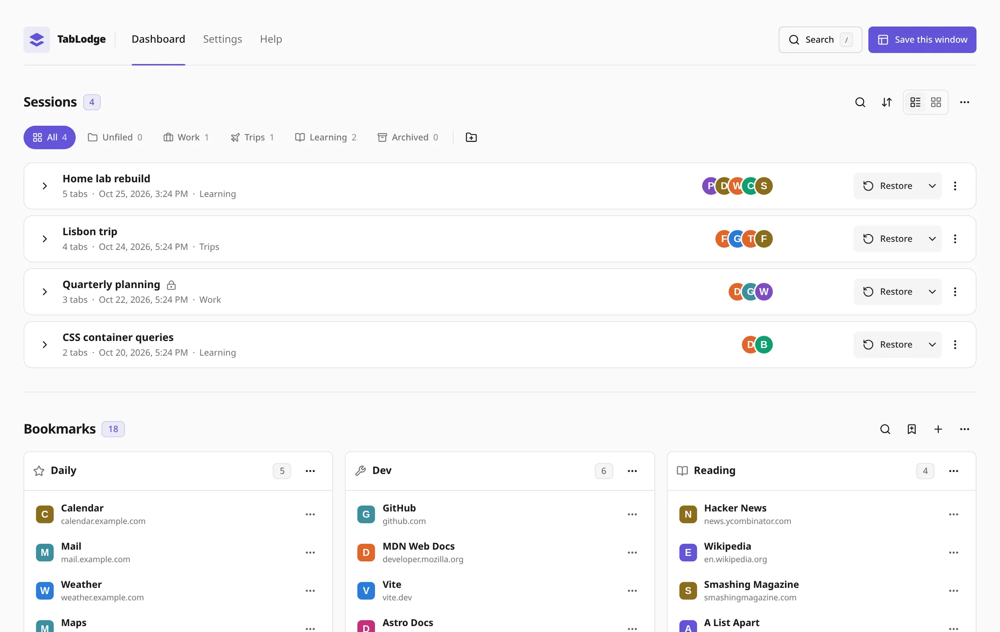
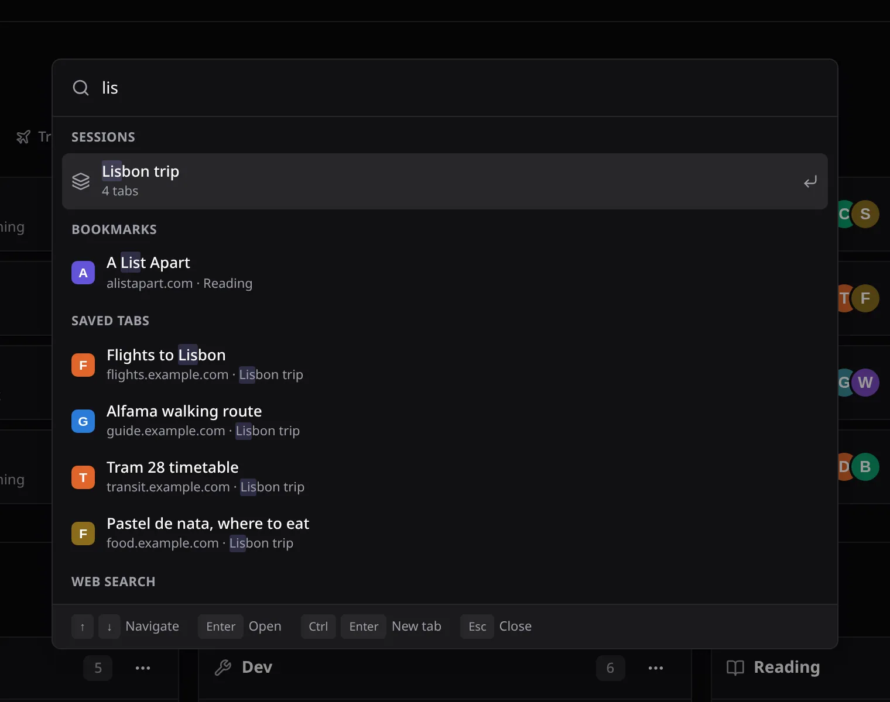
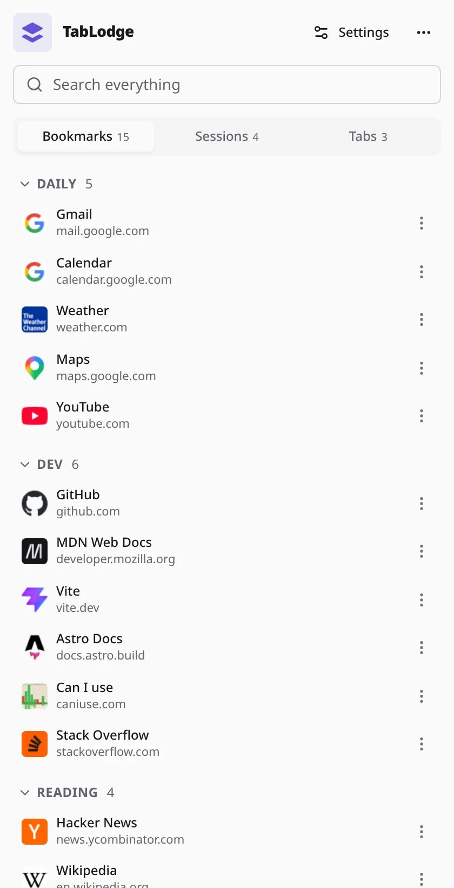

<h1 align="center">
  <br>
  TabLodge
</h1>

<p align="center"><strong>Save your tabs for later. Keep your bookmarks on every new tab.</strong></p>

<p align="center"><a href="https://tablodge.bbay.dev">tablodge.bbay.dev</a></p>
<p align="center"><a href="https://chromewebstore.google.com/detail/tablodge-%E2%80%93-tab-session-ma/ekidoclgpdfhpdlidlkcjccgihbndoib"></a></p>

<p align="center">
  <a href="https://github.com/bberka/TabLodge/actions/workflows/test.yml"></a>
  <a href="../LICENSE"></a>
  
</p>

TabLodge is a browser extension for Chrome, Brave, Edge, Vivaldi, Opera, and other Chromium browsers. Save a window as a named session, close it, and bring it back when you need it. Your new tab page also becomes a board of bookmark columns.

There are no accounts, servers, or analytics. TabLodge keeps your data in your browser profile and doesn't sync it between devices.

## What you can do

- **Save and restore sessions.** Save selected tabs, a tab group, tabs to the left or right, a whole window, or all windows. Restores preserve tab groups and, if you choose to save them, pinned tabs. Split view pairs restore side by side on Chromium 155 or newer.
- **Keep sessions organized.** Use folders, icons, descriptions, search, sorting, and custom ordering. Move sessions between folders or merge them without duplicate links. Name sessions yourself, use a template, or have TabLodge ask each time. An optional setting moves sessions you haven't opened or edited for 30 days to a year into an Archived folder, without deleting anything.
- **Choose how restores work.** Open a session in the current window or a new one. Keep or remove saved links afterward, skip URLs that are already open, and optionally unload restored background tabs. Ctrl/Cmd and Shift clicks let you override the usual behavior for one restore. **Switch to this session** (a menu item on the dashboard, a button in the popup and side panel) saves the window's tabs as a new session and opens the chosen one in their place. A setting, off by default, can remove common tracking parameters when opening saved links without changing the stored URLs.
- **Build a bookmark board.** Search your bookmarks, reorder columns and links by dragging, or paste a list of links to add them. You can also drag links from saved sessions into a column, and drag a link from a web page, a bookmark, or another window onto a saved session to add it there. Choose the default, wider, full width, or narrower dashboard layout in Settings.
- **Bring your data with you.** Import from OneTab, Session Buddy, Tab Session Manager, Toby, or browser bookmarks. Export JSON backups, HTML, CSV, Markdown, or URL lists. A full backup ZIP includes settings and recovery data as well.
- **Recover from mistakes.** Snapshots of open windows help after a browser crash. Deleted sessions, links, bookmarks, and columns go to the trash bin, and many actions offer Undo. Automatic backups are optional, with an extra copy in Downloads if you want one.
- **Use the view that suits you.** Open the toolbar popup, the dashboard, or the side panel for bookmarks, sessions, and open tabs. The side panel marks open tabs whose address is already saved in a session or bookmark. Keyboard shortcuts and context menus give you quick save and bookmark actions. Light, dark, and system themes are available.

## Screenshots

<p align="center">
  
</p>
<p align="center">
  
  
</p>

## Install on Chromium-based browsers

[Install TabLodge from the Chrome Web Store](https://chromewebstore.google.com/detail/tablodge-%E2%80%93-tab-session-ma/ekidoclgpdfhpdlidlkcjccgihbndoib) in Chrome, Brave, Edge, Vivaldi, Opera, or another supported Chromium browser. The same listing works across these browsers, so you do not need a separate listing or a manual install. Choose the install option shown by your browser. The store handles updates automatically.

#### Test a development build

With the Vite+ CLI installed as described in [Development](#development), clone the repository and run TabLodge in its isolated test browser profile:

```sh
git clone https://github.com/bberka/TabLodge.git
cd TabLodge
corepack enable
pnpm install
vp run dev
```

#### Full local installation

To install a release manually instead of using the Chrome Web Store:

1. Download `tablodge-0.x.y.zip` from the [latest release](https://github.com/bberka/TabLodge/releases/latest).
2. Unzip it into a folder you'll keep, such as `~/Extensions/tablodge`. The browser loads the extension from this folder, so don't delete it.
3. Open `chrome://extensions`, `brave://extensions`, `edge://extensions`, or your browser's equivalent.
4. Turn on **Developer mode**.
5. Click **Load unpacked** and select the folder containing `manifest.json`.
6. Pin TabLodge from the extensions menu if you want its toolbar button nearby.

To update a manual installation, download the new release, replace the contents of the same folder, and click the reload button on TabLodge's extension card. Keep using the same folder so the browser keeps the same extension ID and storage.

### Build from source

To build and package TabLodge, you'll need Git, Node.js 22.18+ or 24.11+, pnpm, and the Vite+ CLI. See [Development](#development) to install Vite+. `corepack enable` makes the pnpm version pinned in `package.json` available. You do not need a separate ZIP utility. A Chromium browser is needed only to load or test the build.

```sh
git clone https://github.com/bberka/TabLodge.git
cd TabLodge
corepack enable
pnpm install
vp run build
vp run pack
```

The build creates and verifies the unpacked extension in `dist/tablodge/`. The pack task creates `release/tablodge-<version>.zip` and its `.sha256` checksum. The ZIP contains the extension files at its root, ready to upload or distribute.

Open your browser's extensions page, turn on **Developer mode**, and use **Load unpacked** to select `dist/tablodge/`. Don't select the repository root or `extension/`; those contain source files, not the built extension.

To update a source installation:

```sh
git pull
pnpm install
vp run build
```

Then reload TabLodge from the extensions page.

### After installing

TabLodge opens the dashboard in a new tab after installation. Open another new tab for the dashboard or click the toolbar icon for the popup. To use the side panel, choose it from the toolbar icon's context menu or set **Settings › Side panel › Toolbar icon opens**. In Brave, you can also add TabLodge from the browser sidebar.

Find the available keyboard shortcuts in **Settings › Keyboard shortcuts**. **Configure shortcuts** opens your browser's shortcut settings.

### Move from a manual installation to the Chrome Web Store

The manual and Chrome Web Store installations may have separate storage. Before removing the manual copy, open it and create a full backup in **Settings › Data › Back up › Everything**. Install TabLodge from the Chrome Web Store, import that ZIP from **Settings › Data**, and check that your sessions and bookmarks are there. Remove the manual copy only after confirming the import. Uninstalling an extension removes its browser storage.

Before uninstalling any copy, export anything you want to keep.

## Development

TabLodge uses TypeScript, React 19, Radix primitives, Lucide icons, and Tailwind CSS 3. Vite+ builds the extension and runs Vitest. Playwright launches Chrome or Chromium for manual browser testing. [XO](https://github.com/xojs/xo) handles linting and formatting. All runtime dependencies are bundled with the extension. Install the [Vite+ CLI](https://viteplus.dev/) once and open a new terminal, then run `vp run <task>` directly from the repository root. Use `pnpm install` to install project dependencies.

| Command                              | What it does                                                        |
| ------------------------------------ | ------------------------------------------------------------------- |
| `vp run build`                       | Build into `dist/tablodge/` and verify the package                  |
| `vp run pack`                        | Create a versioned ZIP and SHA256 checksum under `release/`         |
| `vp run browser:install`             | Install Playwright Chromium for development                         |
| `vp run dev`                         | Watch sources and open Chrome or Chromium with the extension loaded |
| `vp run dev:seed`                    | Open the dev browser with repeatable sample sessions and bookmarks  |
| `vp run watch`                       | Watch sources without opening a browser                             |
| `vp run test`                        | Run the tests once                                                  |
| `vp run test:watch`                  | Run tests as files change                                           |
| `vp run typecheck`                   | Check all TypeScript projects                                       |
| `vp run lint`                        | Check code with XO                                                  |
| `vp run lint:fix` or `vp run format` | Fix lint issues and format with XO                                  |
| `vp run check`                       | Run lint, type checks, and tests                                    |
| `vp run verify`                      | Verify an existing build                                            |
| `vp run clean`                       | Remove build output and TypeScript build caches                     |

To run TabLodge in a browser, use:

```sh
vp run dev
```

This builds the extension, watches for source changes, and opens Chrome. If Chrome is unavailable, Playwright uses its own Chromium browser. The window can be resized with your window manager. The browser profile lives in `.dev/chrome-profile` and is separate from your regular profile and other worktrees. After a rebuild, open `chrome://extensions`, reload TabLodge, then reopen its page. Use the page's DevTools console to check page errors. Use the service worker's Inspect link on `chrome://extensions` to check worker errors.

To open it with sample sessions and bookmarks for UI checks or screenshots, run:

```sh
vp run dev:seed
```

This replaces TabLodge data in the worktree's dev profile. If `~/.cache/tablodge/dev-favicons.json` is missing sample site icons, the command fetches them and adds them to the cache shared by worktrees. Later runs use that cache. Delete the file to fetch the icons again. Only this dev command fetches the icons. The extension itself makes no network requests for them and gains no permissions.

If Chrome is not installed, install Playwright Chromium once:

```sh
vp run browser:install
```

If Chrome is installed outside the usual path, set `CHROME_BIN` to its executable. If no browser is available, the build watcher still runs.

See [Contributing](CONTRIBUTING.md) for code conventions, testing, and releases. [Architecture](architecture.md) explains storage, messages, and feature behavior. AI agents also follow [AGENTS.md](../AGENTS.md) and the [validation gate](agent-validation.md).

### Project structure

```text
extension/              Manifest, icons, HTML shells, service worker, and theme boot script
src/app/                Extension pages, shared page code, data types, and messages
src/components/ui/      Local UI primitives built with Radix and Tailwind
src/shared/             Shared UI helpers and theme handling
src/lib/                Small utilities
styles/                 Tailwind entry and theme tokens
tests/                  Vitest suites and mocked browser APIs
scripts/                Build, Chrome development launch, package verification, and release tooling
docs/                   All documentation except AGENTS.md: this README, contributing, privacy, architecture, and agent workflow
site/                   Astro website for tablodge.bbay.dev
tsconfig/               TypeScript projects for the pages, service worker, tests, and build tooling
tsconfig.json           Solution file that `tsc -b` follows into tsconfig/
vite.pages.config.ts    Extension page build configuration
xo.config.ts            Lint and formatting rules
AGENTS.md               Rules and documentation map for AI agents
skills-lock.json        Pinned agent skills, restored with `vp run skills:install`
```

## Permissions and privacy

TabLodge has no website host permissions, injects no content scripts, and makes no network requests of its own. By default, opening a saved page uses its saved URL. The optional tracking setting removes common tracking parameters from the destination but leaves your saved data unchanged. Choosing **Search the web** sends a search through your browser's default engine.

| Permission         | Why it's needed                                                                           |
| ------------------ | ----------------------------------------------------------------------------------------- |
| `tabs`             | Read tab details to save sessions, find duplicates, and work with open tabs               |
| `tabGroups`        | Save and recreate native tab groups                                                       |
| `bookmarks`        | Import browser bookmarks and, if enabled, offer to add newly bookmarked pages             |
| `favicon`          | Show icons from the browser's local favicon cache                                         |
| `storage`          | Store sessions, bookmarks, settings, and recovery data locally                            |
| `unlimitedStorage` | Allow libraries larger than the default storage quota; available disk space still matters |
| `contextMenus`     | Add save and bookmark actions to browser context menus                                    |
| `clipboardWrite`   | Copy bookmark URLs and session links when you ask                                         |
| `sidePanel`        | Show bookmarks, sessions, and open tabs in the browser side panel                         |
| `search`           | Use the default search engine when you choose **Search the web**                          |
| `alarms`           | Schedule snapshots, backups, trash cleanup, and archiving                                 |

The optional `downloads` permission is requested only when you enable **Settings › Recovery & backups › Also save a copy to Downloads**. It writes backup JSON files to `Downloads/TabLodge/`. Turning the setting off removes the permission.

The manifest also replaces the new tab page and declares keyboard shortcuts. You can change what new tabs show in Settings without disabling the rest of TabLodge.

See [Privacy](PRIVACY.md) for what is stored, how recovery data is retained, and how to remove it.

## Future work

Ideas still worth exploring include more actions for open tabs across windows, recently closed tabs in search, storage that scales better for large libraries, more session editing tools, and optional unloading of idle tabs. These are ideas, not promised release dates.

Research notes live in the issue tracker. The [tab manager comparison notes](https://github.com/bberka/TabLodge/issues/21#issuecomment-6470138750) explain the reasoning and link to the original sources. The [mobile app research](https://github.com/bberka/TabLodge/issues/1#issuecomment-6470139241) recommends staying extension-first and validating demand for phone link capture before considering a native companion or cross-device sync.

## Website

The website lives in [`site/`](../site). Run `vp run site:dev` to work on it or `vp run site:build` to build it. [Website setup](website.md) covers deployment and screenshots.

## Contributing

Bug reports, ideas, and pull requests are welcome. Read [Contributing](CONTRIBUTING.md) before opening a pull request. For larger changes, open an issue first so we can discuss the approach.

## License

[MIT](../LICENSE) © 2026 Berkay
